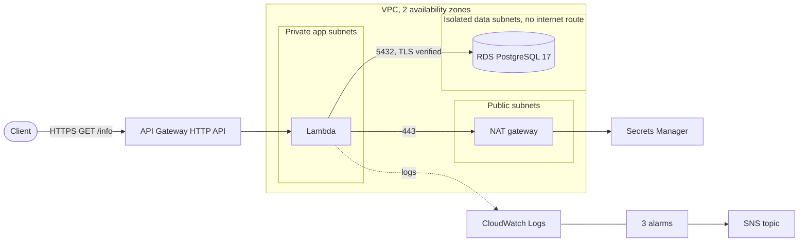

# GET /info on AWS: API Gateway, Lambda and PostgreSQL in a VPC

A Terraform solution to the NaN Labs Cloud Infrastructure Engineer Challenge (the
original statement is in [docs/challenge.md](docs/challenge.md)).

`GET /info` calls a Lambda that runs in a private subnet, connects to a PostgreSQL
RDS instance in an isolated subnet over verified TLS, and returns the connection
status and details about the database. The Lambda reaches Secrets Manager through
a NAT gateway in a public subnet. Logs go to CloudWatch.



## Status

| What | State |
| ---- | ----- |
| Terraform: format, validate, tflint, checkov | passes (`make check`) |
| Terraform tests against a mocked AWS (no account needed) | 20 runs pass: 18 across the five modules and 2 that apply the whole stack |
| Function: lint, 11 unit tests, 3 integration tests against PostgreSQL 17 | passes |
| The real handler against PostgreSQL 17 (`make local-up && make local-invoke`) | answers 200 with the database details |
| GitHub Actions | runs the same `make` targets on every pull request |
| **Deployed to AWS: live endpoint and CloudWatch logs** | **not yet**; needs an AWS account. Steps below |

## What it deploys

| Layer | Resource |
| ----- | -------- |
| Entry | API Gateway HTTP API with one route, `GET /info`, throttled, with access logs |
| Compute | Lambda (Python 3.13, arm64) in the private app subnets, JSON logs |
| Data | RDS PostgreSQL 17 in isolated subnets: encrypted, private, TLS required, 7-day backups, Multi-AZ as a setting |
| Network | VPC, three subnet tiers in two zones, internet gateway, one NAT gateway, security groups |
| Secrets | Database password created and rotated by RDS in Secrets Manager |
| Monitoring | Three alarms (database CPU, Lambda errors, API 5xx) to an SNS topic, optional email |

## Requirements checklist

| Requirement | Where |
| ----------- | ----- |
| API Gateway with a single `GET /info` endpoint | `terraform/modules/api` |
| Lambda triggered by it | `terraform/modules/lambda`; the invoke permission is limited to that route |
| Database in a private subnet | `terraform/modules/database`; the data subnets have no route out |
| Lambda connects and returns status and metadata | `function/handler.py` |
| Logs in CloudWatch | a log group with retention for the function, another for the API |
| VPC, public and private subnets, security groups | `terraform/modules/network` |
| Lambda in a private subnet, NAT gateway in a public subnet | the app subnets route `0.0.0.0/0` to the NAT gateway |
| IaC module, README with deployment steps and tool justification | `terraform/`, this file, [docs/decisions.md](docs/decisions.md) |
| Multi-AZ, backups | `db_multi_az` (off by default), 7 days of point-in-time backups |
| GitHub Actions, pre-commit | `.github/workflows/ci.yml`, `.pre-commit-config.yaml` |
| CloudWatch alarms | `terraform/modules/monitoring` |
| Docker for local testing | `local/` |
| Load balancer or CloudFront | not included, see [docs/decisions.md](docs/decisions.md) |

## Deploy

You need an AWS account and credentials in your environment. Terraform 1.11 or
newer (developed on 1.15.9) and [uv](https://docs.astral.sh/uv/) (it fetches
Python 3.13 for the build) are required; the AWS CLI is needed for the state
bucket and `make logs`.

The state lives in an S3 bucket, shared by `make` and by the GitHub workflow
(see below), so both always see the same infrastructure. Create it once per
account (the name must be globally unique):

```bash
export STATE_BUCKET=<globally-unique-name>
make state-bucket              # versioned, encrypted, no public access
```

Then, for the environment (`dev` or `prod`) and region you want:

```bash
make plan ENV=dev REGION=us-east-1      # builds the package, saves the plan to review
make apply ENV=dev REGION=us-east-1     # applies exactly that plan
make verify ENV=dev REGION=us-east-1    # calls the endpoint and prints the JSON
make logs ENV=dev REGION=us-east-1      # tails the Lambda's CloudWatch logs
make destroy ENV=dev REGION=us-east-1 CONFIRM=dev   # the NAT gateway and database bill by the hour
```

`ENV` and `REGION` default to `dev` and `us-east-1`. Each pair has its own state
(`info-api/<env>/<region>/terraform.tfstate`). Settings per environment are in
`terraform/environments/`:

| Setting | dev | prod |
| ------- | --- | ---- |
| NAT gateways | one shared | one per zone |
| Database standby (Multi-AZ) | no | yes |
| Backups | 7 days | 14 days |
| Deletion protection, final snapshot | off, so it is easy to destroy | on |

Prod's deletion protection means `destroy` fails until
`db_deletion_protection = false` is applied first. That friction is intended.
Other variables (such as `alert_email`) are in `terraform/variables.tf`; set them
with `TF_VAR_alert_email=you@example.com make plan`.

If a run is interrupted and the state stays locked, Terraform prints a lock ID:
`make unlock ENV=dev REGION=us-east-1 CONFIRM=dev LOCK_ID=<id>`.

A successful `make verify` prints (abridged):

```json
{
  "status": "ok",
  "database": {
    "connected": true,
    "engine": "postgres",
    "version": "17.x",
    "tls": true,
    "latency_ms": 31.4
  },
  "instance": { "class": "db.t4g.micro", "multi_az": false, "availability_zone": "us-east-1a" }
}
```

If the database cannot be reached the API answers `503` with `database.error` set
to one of `timeout`, `tls`, `authentication`, `credentials`, `unavailable` or
`configuration`, and nothing else: no host, user or exception text. The details go
to the log, under the same `request_id`.

**Cost.** A NAT gateway is $0.045 per hour and its public IPv4 address $0.005 per
hour (both confirmed on AWS's pricing pages). The `db.t4g.micro` instance is
roughly $0.016 per hour (from memory, unverified). Left running, the default
deployment costs on the order of $50 a month, so a short test is well under a
dollar. Check the [AWS Pricing Calculator](https://calculator.aws/) before relying
on any figure.

## Local testing

```bash
make local-up          # PostgreSQL 17 in Docker on 127.0.0.1:5432
make local-invoke      # run the real handler once and print the response
set -a; . local/.env; set +a; make integration
make local-down
```

The handler runs in your Python process, with TLS off, because the local server has
no certificate. This cannot show the VPC, the NAT gateway, Secrets Manager or TLS
verification against the RDS certificate; those only exist once deployed.

## Checks

```bash
make check     # format, validate, tflint, checkov, all Terraform tests, ruff, function unit tests
make test      # Terraform tests only
```

The Terraform tests use a mocked AWS provider, so they need no account. Beyond the
per-module tests, one test applies the whole stack, as a first real apply would,
which catches wiring mistakes the module tests cannot.

## Security

- The database sits in subnets with no route to the internet and accepts connections
  only from the Lambda's security group, on one port. The default security group
  has no rules.
- RDS generates and rotates the password in Secrets Manager. It is never in the
  code, the variables or Terraform state.
- The server requires TLS and the function verifies the certificate and hostname
  against the bundled RDS certificate bundle.
- The Lambda's role is AWS's managed VPC execution policy plus one statement: read
  the database secret. Nothing else.
- Failure responses carry a reason category only.
- Providers and Python dependencies are locked with hashes, workflow actions are
  pinned to commit SHAs and the CI token is read-only.

The endpoint is public and has no authorizer: the challenge asks for a working
public endpoint and the response is not sensitive.

## Limits

- **Not deployed here.** The live endpoint and logs need an AWS account.
- **A shared NAT gateway** is a single point of failure for the Lambda's outbound
  access; `nat_gateway_per_az = true` fixes it at the cost of a second gateway.
- **No load balancer or CloudFront.** An HTTP API cannot use WAF, so that would mean
  CloudFront in front.
- Anything beyond the brief was left out on purpose, with what I would add for
  production, in [docs/decisions.md](docs/decisions.md).

## Layout

```text
terraform/
  modules/        network, database, lambda, api, monitoring (each with tests)
  environments/   dev.tfvars and prod.tfvars
  tests/          applies the whole stack against a mocked provider
function/    the Lambda: handler, tests, sample event, local invoker
local/       Docker Compose for a local PostgreSQL
docs/        decisions, and the original challenge statement
Makefile     the entry point for every task
```
